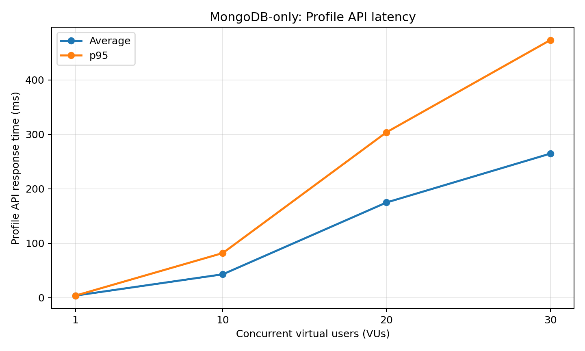
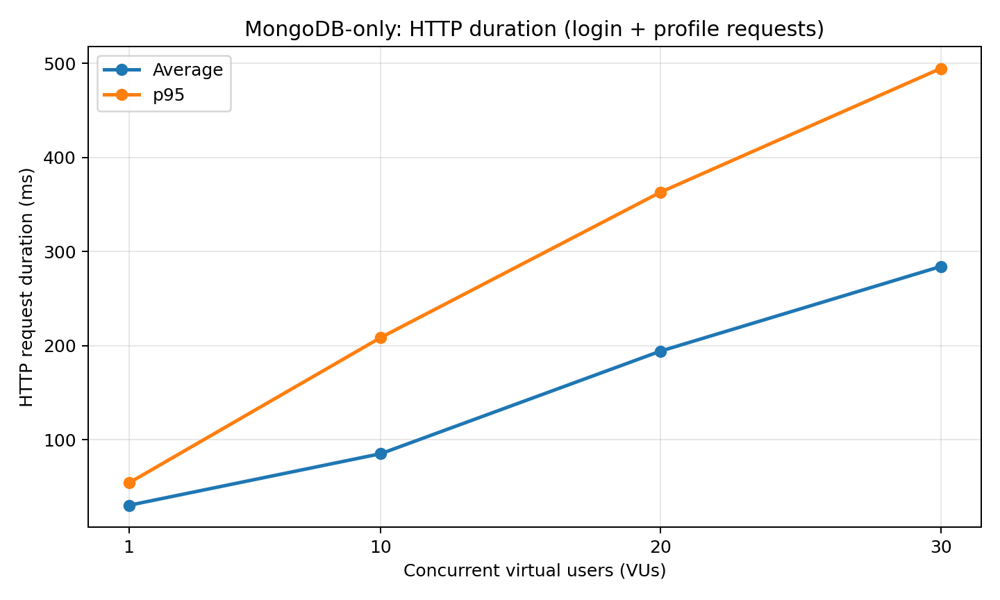
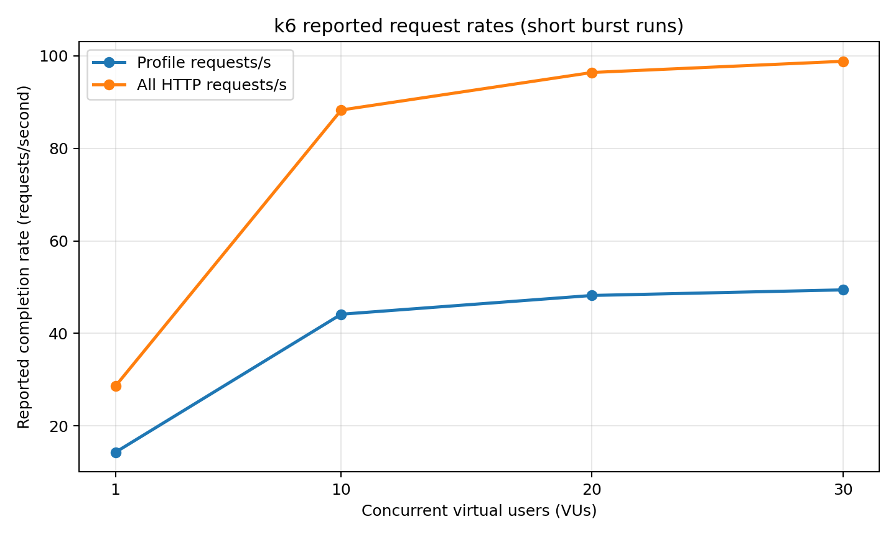

# VibeSpace Profile API — MongoDB-only Baseline

> **Baseline:** MongoDB-only implementation (Redis not enabled for this evaluation)  
> **Load tool:** k6  
> **Test type:** Short burst test — one iteration per virtual user  
> **Endpoint under evaluation:** `GET /api/v4/users/profile/:userId`  
> **Authentication:** Each VU logs in first, then requests one profile.

## 1. Purpose

This report records the initial performance of the VibeSpace profile endpoint before Redis caching or further query optimizations. It provides a baseline for a later, like-for-like comparison.

## 2. Test setup and workload

| Item | Value |
|---|---|
| Application | VibeSpace `server1` |
| API base URL | `http://localhost:9000` (from the k6 script default) |
| Load generator | k6, local execution |
| Test data | 161 valid test-user records loaded by the script |
| VU levels included | 1, 10, 20, 30 |
| Iterations | 1 per VU |
| Requests per iteration | 1 login + 1 profile request |
| Redis | Not used in this baseline |
| Profile latency metric | Custom k6 `profile_duration` Trend |

Each VU performs a login followed by a single profile request. Therefore, the test creates a short burst of traffic rather than a sustained workload.

## 3. Results summary

The table below uses the successful runs supplied for 1, 10, 20 and 30 VUs. The first 30-VU attempt that crossed the p95 threshold was excluded; the subsequent 30-VU run passed the configured threshold.

| Concurrent VUs | Profile requests | Profile avg (ms) | Profile median (ms) | Profile p90 (ms) | Profile p95 (ms) | Profile max (ms) | Profile failures |
|---:|---:|---:|---:|---:|---:|---:|---:|
| 1 | 1 | 3.74 | 3.74 | 3.74 | 3.74 | 3.74 | 0% |
| 10 | 10 | 42.90 | 24.46 | 80.98 | 81.93 | 82.88 | 0% |
| 20 | 20 | 174.87 | 177.68 | 302.07 | 303.94 | 311.15 | 0% |
| 30 | 30 | 264.63 | 281.44 | 472.08 | 473.29 | 474.20 | 0% |

### Overall HTTP metrics

`http_req_duration` aggregates both HTTP calls in each iteration (login and profile). It should not be confused with the custom `profile_duration` metric, which measures only the profile request.

| Concurrent VUs | Total HTTP requests | HTTP avg (ms) | HTTP p95 (ms) | HTTP failures |
|---:|---:|---:|---:|---:|
| 1 | 2 | 30.18 | 53.98 | 0% |
| 10 | 20 | 85.09 | 208.64 | 0% |
| 20 | 40 | 194.23 | 363.28 | 0% |
| 30 | 60 | 284.13 | 494.69 | 0% |

## 4. Charts

### Profile API latency



### Overall HTTP duration (login + profile)



### Reported request completion rates



The rates below are the rates k6 reported for these very short tests. They are **not evidence of sustained capacity or a stable requests-per-second limit**.

| Concurrent VUs | Profile requests/s | All HTTP requests/s |
|---:|---:|---:|
| 1 | 14.31 | 28.61 |
| 10 | 44.15 | 88.29 |
| 20 | 48.20 | 96.40 |
| 30 | 49.41 | 98.82 |

## 5. Observations

1. All included runs completed their login and profile checks successfully; the reported HTTP failure rate was 0%.
2. Profile API average latency rose from 3.74 ms at one sample to 264.63 ms at 30 VUs.
3. Profile p95 rose from 81.93 ms at 10 VUs to 473.29 ms at 30 VUs.
4. In the 30-VU successful run, the custom profile p95 was below the configured 500 ms threshold (473.29 ms).
5. The 1-VU result contains only one profile sample. Its average, median, p90 and p95 are all the same value and should not be treated as a statistically reliable percentile.
6. The reported request rates come from sub-second burst runs. They should not be presented as sustained throughput or a production capacity claim.

## 6. Interpretation and limitations

- These tests were run locally on the developer's PC. Results depend on the machine's available CPU, memory, background activity, network and database location.
- Each VU performs only one iteration. This measures a burst of one login and one profile request per VU, not repeated browsing over time.
- The samples are small (1, 10, 20 and 30 profile requests respectively). Repeat each workload several times and report the median or distribution across runs before using the numbers as a formal benchmark.
- `profile_duration` measures the profile HTTP response timing captured by k6. The Node.js controller timings (`userQueryTime`, `countsQueryTime`, `totalTime`) are separate measurements and are not included in this report because no corresponding server timing logs were supplied.
- The measurements do not establish the cause of latency growth. Database indexes, MongoDB connection-pool behavior, network round trips, application CPU and local machine contention still need investigation.

## 7. Baseline conclusion

Under this specific local burst-test setup, the MongoDB-only profile endpoint completed all included requests successfully. At 30 concurrent VUs, the successful run recorded an average profile response time of **264.63 ms** and p95 of **473.29 ms**.

This report is the pre-optimization baseline. Future Redis and query-optimization tests should use the same test script, dataset, machine, database/index configuration and workload shape wherever possible.

## 8. Reproducing the test

From `server1/load-testing`:

```bash
k6 run profile-load-test.js
```

Set the VU count in the scenario configuration to 1, 10, 20 or 30 before each run. Keep the script and environment consistent across baseline and optimized evaluations.

## 9. Suggested Git hygiene

Do not commit `users.json` if it contains real user identifiers or email addresses. Keep credentials and tokens out of the repository. Publish the load-test script only after ensuring secrets are supplied through environment variables and the test dataset is synthetic or safely anonymized.
